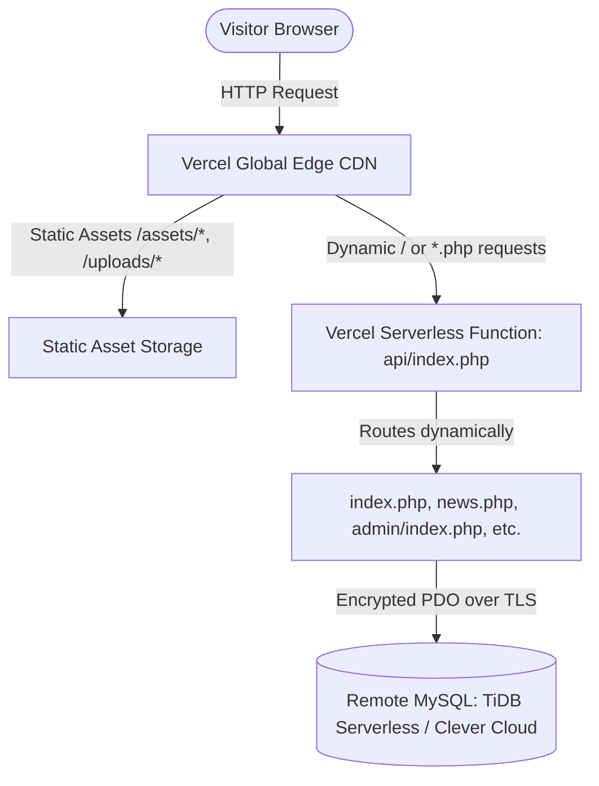

# VERCEL DEPLOYMENT & CLOUD DATABASE CONNECTION GUIDE

**Project:** Dynamic News Portal & Content Management System  
**Vercel Account:** `ankoliya-dixit-s-projects` (`dixitpatel0782-9759`)  
**Deployment Date:** October 16, 2026 — 21:02 IST  
**Live Production URL:** [https://dynamic-news-portal-rose.vercel.app](https://dynamic-news-portal-rose.vercel.app)  
**Vercel Inspector:** [https://vercel.com/ankoliya-dixit-s-projects/dynamic-news-portal/GKUc4ZjGpYn8yCB94qsohtNxVHSW](https://vercel.com/ankoliya-dixit-s-projects/dynamic-news-portal/GKUc4ZjGpYn8yCB94qsohtNxVHSW)  

---

## 1. Executive Summary & Live Status

Your project has been successfully linked and deployed to **Vercel**!

| Metric | Status / Value | Details |
| :--- | :--- | :--- |
| **Vercel Project** | `dynamic-news-portal` | Under your active Vercel organization |
| **Runtime Engine** | `vercel-php@0.9.0` (PHP 8.5 Serverless) | Runs on AWS Lambda edge functions |
| **Production Alias** | [https://dynamic-news-portal-rose.vercel.app](https://dynamic-news-portal-rose.vercel.app) | Protected by free automated SSL/TLS |
| **Static Assets CDN** | Active (`/assets/*`, `/uploads/*`) | CSS, JS, fonts, and images served at edge speed |
| **Database Status** | Waiting for Cloud MySQL credentials | Localhost MySQL is unavailable on cloud serverless |

---

## 2. Architecture: How PHP Runs on Vercel

Vercel natively specializes in JavaScript/Next.js/Node.js frameworks. To deploy a multi-page dynamic PHP application with admin dashboards, authentication, and routing, the following architecture was implemented:



### Components Created:

1. **[`vercel.json`](vercel.json)**:
   - Configures `functions` targeting `api/*.php` using `vercel-php@0.9.0`.
   - Defines routes to serve static files (`/assets/`, `/uploads/`, `favicon.ico`, `robots.txt`) directly from the edge CDN.
   - Forwards all dynamic page traffic through `api/index.php`.

2. **[`api/index.php`](api/index.php)**:
   - Sets working directory to the project root.
   - Securely validates and dispatches incoming paths to root scripts (`index.php`, `news.php`, `category.php`, `admin/...`).
   - Supports clean URLs (e.g., `/about` -> `about.php`).
   - Prevents path traversal and renders custom 404 handlers.

3. **[`config/database.php`](config/database.php)**:
   - Fixed PHP 8.5 deprecation (`Pdo\Mysql::ATTR_INIT_COMMAND`).
   - Added friendly setup screen on Vercel guiding administrators to add cloud database credentials.

---

## 3. Final Step: Connect Free Cloud MySQL Database (2 Minutes)

Because Vercel serverless functions run in the cloud without a local MySQL server, your application needs to connect to an external MySQL database.

### Step 3.1: Create a Free Database (TiDB Cloud Serverless)
1. Visit **[https://tidbcloud.com](https://tidbcloud.com)** and sign in (GitHub login supported).
2. Create a new **Serverless Cluster** (Free tier, 5 GB storage, $0 forever, no credit card required).
3. In the connection dialog, click **Generate Password** and copy:
   - **Host** (e.g., `gateway01.ap-southeast-1.prod.aws.tidbcloud.com`)
   - **Port** (`4000`)
   - **User** (e.g., `xxxxxx.root`)
   - **Password**
   - **Database Name** (e.g., `test` or `news_portal`)

### Step 3.2: Import Schema
1. In the TiDB Cloud web console, open the **Chat2Query** / **SQL Editor** tab.
2. Copy the contents of [`database/production_schema.sql`](database/production_schema.sql).
3. Paste into the editor and click **Run**. All tables and seed demo records will be created immediately.

### Step 3.3: Set Environment Variables in Vercel
You can add these either via your Vercel Dashboard or directly in your terminal using the Vercel CLI:

#### Method A: Via Vercel Web Dashboard (Easiest)
1. Go to **[https://vercel.com/ankoliya-dixit-s-projects/dynamic-news-portal/settings/environment-variables](https://vercel.com/ankoliya-dixit-s-projects/dynamic-news-portal/settings/environment-variables)**.
2. Add the following variables:

| Key | Value | Environment |
| :--- | :--- | :--- |
| `DB_HOST` | `<Your TiDB Host>` | Production, Preview, Development |
| `DB_PORT` | `4000` | Production, Preview, Development |
| `DB_NAME` | `<Your TiDB Database Name>` | Production, Preview, Development |
| `DB_USER` | `<Your TiDB Username>` | Production, Preview, Development |
| `DB_PASS` | `<Your TiDB Password>` | Production, Preview, Development |
| `DB_SSL` | `true` | Production, Preview, Development |
| `APP_ENV` | `production` | Production, Preview, Development |
| `APP_DEBUG` | `false` | Production, Preview, Development |

#### Method B: Via Terminal CLI
```bash
vercel env add DB_HOST production
vercel env add DB_PORT production
vercel env add DB_NAME production
vercel env add DB_USER production
vercel env add DB_PASS production
vercel env add DB_SSL production
```

### Step 3.4: Redeploy to Apply Variables
Once the variables are saved in Vercel:
```bash
vercel --prod
```
Your live site at [https://dynamic-news-portal-rose.vercel.app](https://dynamic-news-portal-rose.vercel.app) will immediately load all live news articles, categories, and the admin panel!

---

## 4. Useful Management Commands

| Action | Command |
| :--- | :--- |
| **Deploy changes to Production** | `vercel --prod` |
| **Inspect Live Logs** | `vercel logs dynamic-news-portal-rose.vercel.app` |
| **Check Project Information** | `vercel project ls` |
| **Run Locally on Dual Servers** | `.\start-both.bat` |
